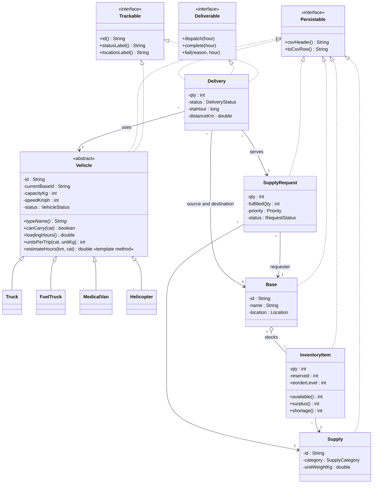
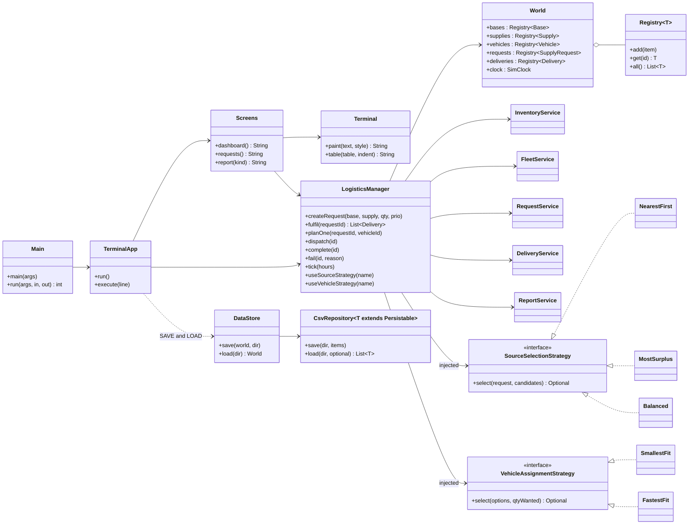
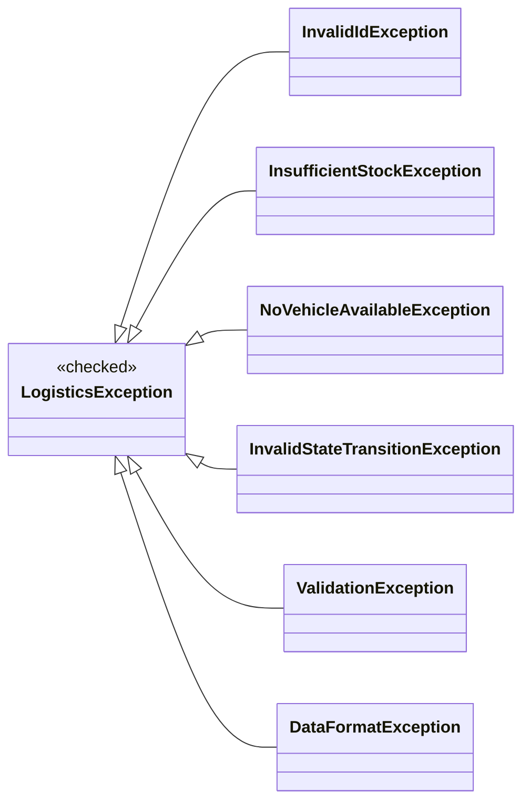

# Class diagrams (Mermaid source; rendered PNGs in docs/img/)
Sources live in `docs/diagrams/*.mmd`. Re-render: `mmdc -p pp.json -i docs/diagrams/X.mmd -o docs/img/class_X.png -s 2 -b white`.

## 1. Domain model

## 2. Services, strategies and persistence

## 3. Exception hierarchy

