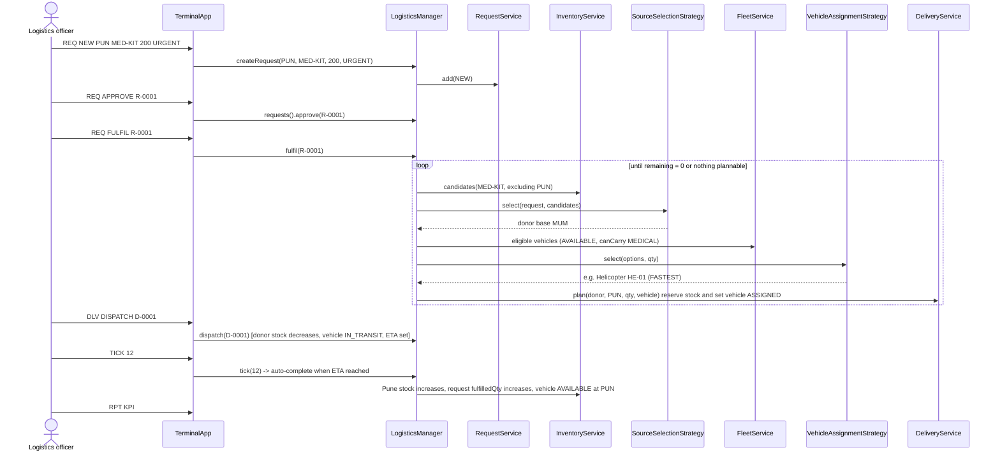

# Demo scenario sequence — "Pune needs medical kits"

## State machines
Request: `NEW → APPROVED → FULFILLING → FULFILLED`; `NEW|APPROVED → REJECTED|CANCELLED`; `FULFILLING → APPROVED` (when a delivery fails and nothing else in flight).
Delivery: `PLANNED → IN_TRANSIT → DELIVERED`; `PLANNED|IN_TRANSIT → FAILED`.
Vehicle: `AVAILABLE → ASSIGNED → IN_TRANSIT → AVAILABLE`; `AVAILABLE ↔ MAINTENANCE`.
