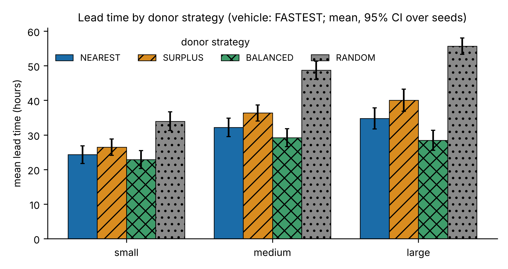
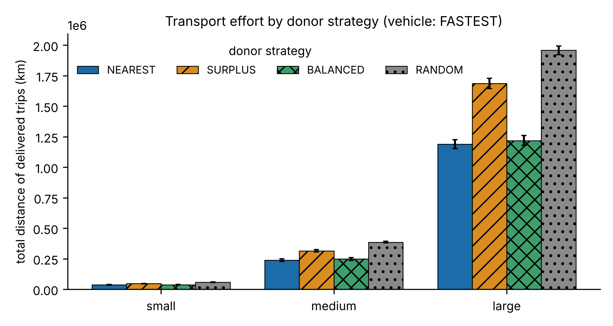
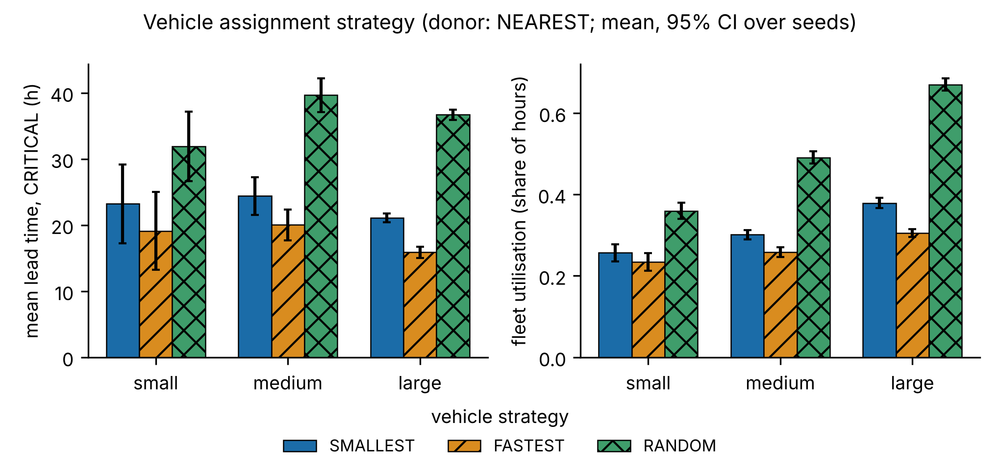
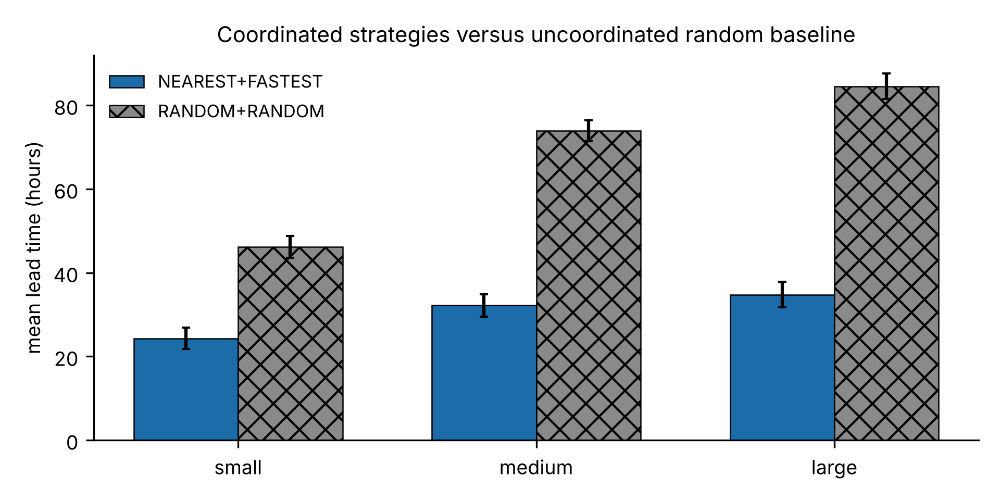
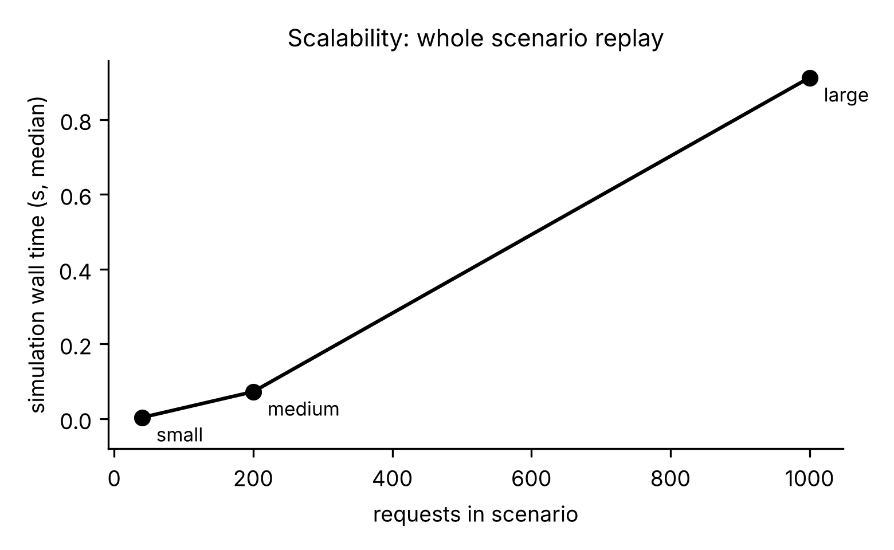
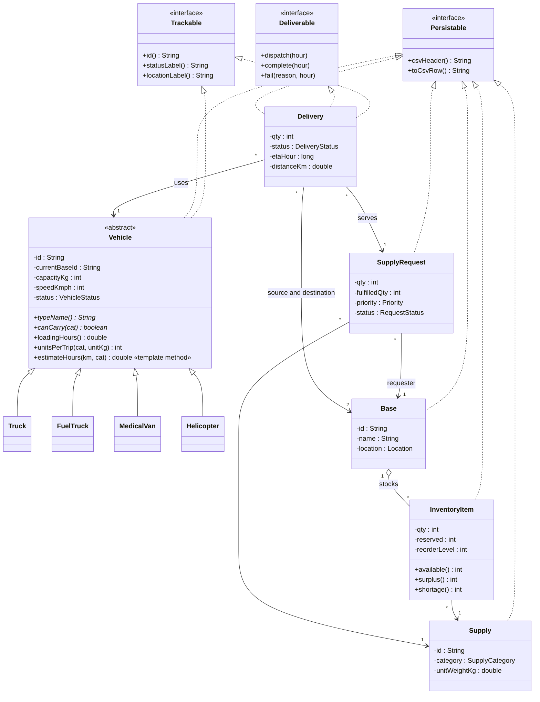
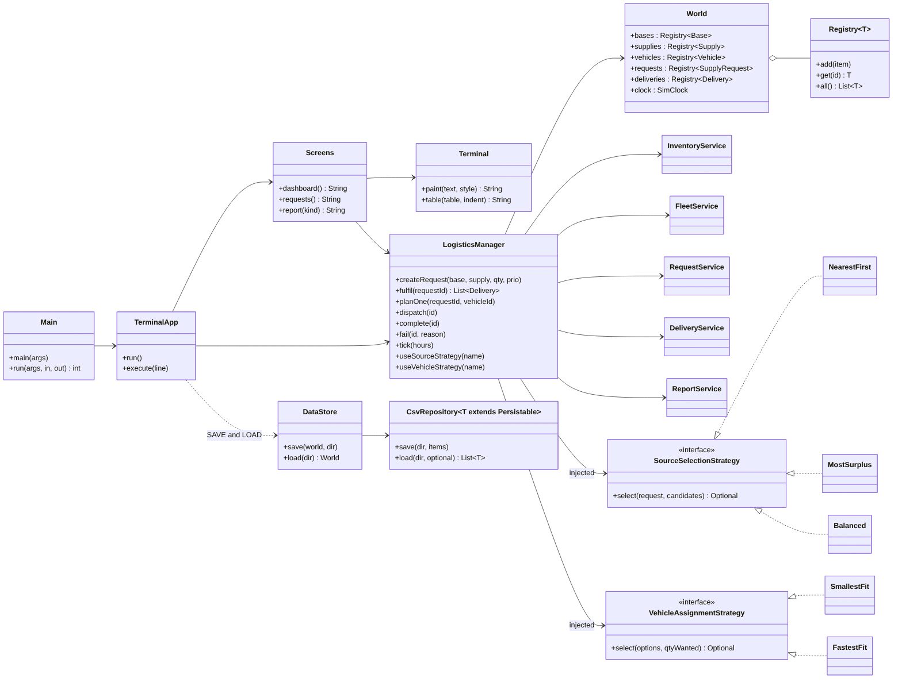
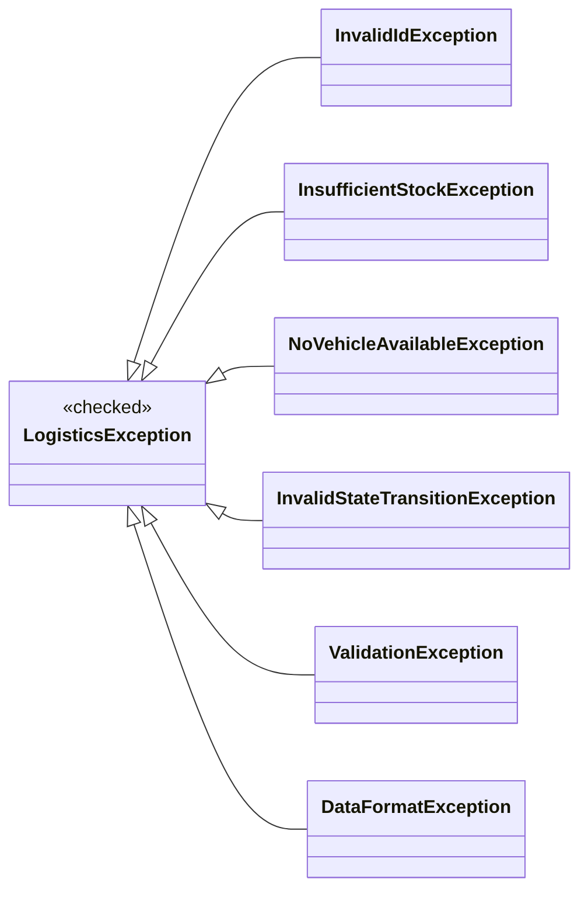
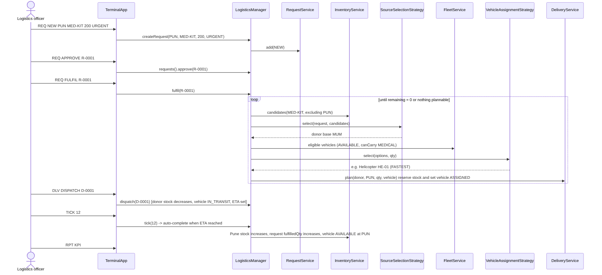

%title Design and Evaluation of an Object-Oriented Defence Logistics and Supply Chain Management System
%authors Vedant Pathak (R045), Dhairya Shah (R057), Kanishak Thakran (R046)
%affil SVKM's NMIMS MPSTME, Mumbai, India
%course Object Oriented Programming — Faculty: Dr. Sakshi Ranjan
%abstract Defence and humanitarian logistics networks suffer from the same four problems: some bases run short while others hold excess stock, deliveries are late, and nobody has a single, trustworthy view of what is where. We present DLSCMS, a Java 17 console application that manages bases, supplies, inventories, vehicles, supply requests and deliveries, and that automatically plans transfers of surplus stock between bases. The design is deliberately object-oriented: an abstract Vehicle hierarchy, interfaces for tracking and persistence, generic registries and repositories, a checked exception hierarchy, and two Strategy interfaces that make donor selection and vehicle selection swappable at run time. Because real defence data is unobtainable, we generated seeded synthetic datasets at three scales (40, 200 and 1,000 requests) and replayed them in an hour-by-hour simulator under 12 strategy combinations, including random baselines, with 30 seeds each (1,080 runs). Coordinated strategies cut mean lead time from 84.5 h to 34.8 h and transport distance by 42% against an uncoordinated random baseline on the largest dataset; a balanced donor rule reduced lead time by a further 6.3 h over nearest-first, and a fastest-vehicle rule trades about 5–9% more distance for 4–8 h faster delivery. About 2% of requests remain unfulfilled; we trace this to donors' reorder floors, a small fuel-truck fleet and the finite simulation horizon. The system is covered by 119 automated tests and runs in about one second on the largest dataset.
%keywords object-oriented design, logistics, supply chain, Java, discrete-event simulation, strategy pattern

## INTRODUCTION
Logistics is the part of an operation that nobody notices until it fails. In a multi-base defence network the typical failure modes are easy to state: a base runs out of medical kits while another base, a few hundred kilometres away, holds more than it needs; a vehicle that could carry the load is idle while the request waits; and the person who must decide has no single view of stock, fleet and open requests. The same structure appears in humanitarian relief [4], [5].

This paper reports the design, implementation and evaluation of DLSCMS, the *Defence Logistics and Supply Chain Management System*, built as a course project in object-oriented programming. The brief asks for a working local model that can add and manage bases, track supplies and inventory, create supply requests, assign vehicles, track deliveries and produce reports, and that demonstrates classes, encapsulation, inheritance, polymorphism, abstraction, interfaces, collections, exception handling, file handling, generics and packages.

Our contributions are:
- **A complete, tested object-oriented model** of a multi-base supply network in about 5,750 lines of Java (including comments) without runtime dependencies, with a terminal interface in the style of a market-data terminal (Section IV and VI).
- **Swappable decision strategies** for choosing the donor base and the vehicle, and a simulator that replays a request stream hour by hour so that strategies can be compared on identical inputs (Section VIII).
- **An experimental study** of 1,080 simulation runs on seeded synthetic data, with confidence intervals, Holm-corrected paired tests, and an explicit analysis of why some requests are not fulfilled (Sections VIII and IX).

The source code, UML design documents, datasets, results and scripts are available in the project repository at `https://github.com/withvedantpathak/defence_logistics_and_supply_chain_management_system_using_objectorientedprogramming`. The rest of the paper is organised as follows. Section II reviews related work. Section III lists the requirements, Section IV describes the design, Section V the dataset, Section VI the implementation, Section VII testing, Section VIII the experiments and results, Section IX discusses them, and Section X concludes.

## RELATED WORK
The vehicle-dispatching literature starts with Dantzig and Ramser's formulation of the truck dispatching problem [1], from which the modern vehicle routing problem developed. DLSCMS does not solve a routing problem: trips are single-leg transfers between two bases, and the interesting decisions are *which* base should supply a request and *which* vehicle should carry it.

Moving stock between locations of the same level of a network, instead of ordering from a central supplier, is studied as *lateral transshipment*; Paterson et al. review the inventory models that use it [3]. Our donor rule, in which a base may give away only the stock above its reorder level, is a simple lateral-transshipment policy. Coelho et al. survey inventory routing, which couples stock decisions with delivery routes [2]; because stock and transport decisions interact, we measure both service (lead time, fulfilment) and transport effort (distance, fleet utilisation) rather than service alone.

Humanitarian and disaster logistics share the multi-base, priority-driven structure of defence logistics. Van Wassenhove discusses supply chain management for humanitarian aid [4], and Altay and Green review operations research work on disaster operations [5]. These settings share the priority-driven structure of defence logistics, which is why we model three priority levels (routine, urgent, critical) and report the lead time of critical requests separately.

On the software side, the Strategy and Facade patterns catalogued by Gamma et al. [6] provide the structure we use for swappable policies and for a single entry point to the services. For evaluation we follow the distinction between verifying that a simulation model is built correctly and validating that it represents the real system [7]. Because no real data is available, we do the former thoroughly and state clearly that the latter is not done (Section IX). For statistics we use paired Wilcoxon signed-rank tests [8] with Holm's sequentially rejective correction for multiple comparisons [9].

## REQUIREMENTS
The requirements were distilled from the project brief into six functional requirements (F1–F6), eleven object-oriented requirements (O1–O11) and a short list of non-functional requirements; Appendix A traces each of them to classes and tests.

**Functional.** F1: add and manage bases (duplicate identifiers and invalid coordinates are rejected; a base holding stock or open deliveries cannot be removed). F2: track supplies and inventory at each base, with reorder levels and shortage alerts. F3: create and manage supply requests with a priority and a lifecycle. F4: list available vehicles and assign one to a delivery, automatically through a strategy or manually. F5: track deliveries and update their status consistently across stock, vehicles and requests. F6: generate basic reports (stock, shortages, deliveries, fulfilment rate, average lead time) with CSV export.

**Object-oriented.** O1 classes and objects; O2 encapsulation; O3 inheritance; O4 polymorphism; O5 abstraction; O6 interfaces; O7 collections; O8 exception handling; O9 file handling; O10 generics; O11 packages.

**Non-functional.** The system runs offline with zero runtime dependencies on Java 17 or newer, is deterministic for a given seed, answers each interactive command in under one second on the largest dataset, persists data as CSV files, and never terminates with a stack trace on malformed input.

## SYSTEM DESIGN
### Architecture
DLSCMS is organised in nine packages (Table I). A single *facade*, `LogisticsManager`, is the only entry point the user interface and the simulator need: it coordinates the inventory, fleet, request, delivery and report services, owns the simulated clock and holds the two currently active strategies. The terminal interface and the simulator are therefore thin clients of the same domain code, which is what allows the experiments in Section VIII to exercise exactly the code the user runs.

Table: Packages and their responsibilities.
| Package | Contents |
|---|---|
| model | Base, Supply, InventoryItem, SupplyRequest, Delivery, enums, interfaces |
| model.vehicle | abstract Vehicle; Truck, FuelTruck, MedicalVan, Helicopter |
| service | LogisticsManager (facade), Inventory-, Fleet-, Request-, Delivery-, ReportService, SimClock, Registry<T> |
| strategy | donor and vehicle selection interfaces and implementations |
| exception | checked LogisticsException hierarchy |
| persistence | CsvRepository<T>, DataStore |
| ui | Terminal, Screens, TerminalApp (command loop) |
| util | Distance (haversine), IdGenerator, Validator, Table |
| sim | Scenario, Simulator, Experiment, random baselines |

### Domain model and OOP concepts
The domain model has five core classes (the full UML class diagrams are in Appendix C, Figs. 6–9): `Base`, `Supply`, `Vehicle` (abstract), `SupplyRequest` and `Delivery`, plus `InventoryItem`, which holds the quantity, reserved quantity and reorder level of one supply at one base. Its methods make the stock rules explicit: `available()` is quantity minus reserved, `surplus()` is the part of `available()` above the reorder level, and `donatable(priority)` is the part a base may give away, with the floor halved for critical requests.

`Vehicle` is abstract and defines the template for trip duration: `estimateHours(km, category)` combines an overridable effective speed with an overridable loading time. Four subclasses specialise it: `Truck` carries everything except fuel; `FuelTruck` carries only fuel and loads slowly; `MedicalVan` carries medical and food items; `Helicopter` is fast, carries a sixth of a truck's load and ignores the road-distance factor. The method `canCarry(category)` is the polymorphic compatibility test used by the fleet service. Table II maps every required OOP concept to its place in the code.

Table: Mapping of the required OOP concepts to the implementation.
| Concept | Where it appears |
|---|---|
| Classes, objects (O1) | Base, Supply, Vehicle, SupplyRequest, Delivery |
| Encapsulation (O2) | private fields, validated constructors, immutable Location record |
| Inheritance (O3) | Truck, FuelTruck, MedicalVan, Helicopter extend Vehicle |
| Polymorphism (O4) | overridden canCarry, capacity, speed and loading hooks; strategy implementations |
| Abstraction (O5) | abstract Vehicle; strategy interfaces |
| Interfaces (O6) | Trackable, Deliverable, Persistable |
| Collections (O7) | Map, List, PriorityQueue, Comparator, EnumMap |
| Exceptions (O8) | LogisticsException hierarchy (6 checked types) |
| File handling (O9) | CsvRepository, DataStore |
| Generics (O10) | CsvRepository<T extends Persistable>, Registry<T> |
| Packages (O11) | nine packages (Table I) |

### Strategies
Two interfaces make the key decisions replaceable. A `SourceSelectionStrategy` chooses the donor from the list of bases that have spare stock: *NEAREST* minimises distance; *SURPLUS* takes from the base with the most spare units, which protects small donors; *BALANCED* maximises 0.5(1 − d/d_max) + 0.5(s/s_max), where d is the distance and s the spare stock. A `VehicleAssignmentStrategy` chooses among the vehicles that can make the trip: *SMALLEST* picks the smallest vehicle that carries the whole load and otherwise the largest available, and *FASTEST* picks the minimum estimated trip time. Strategies are injected into the facade through its constructor and can be switched during a session with the `STRAT` command, which is how the experiments vary them.

### Lifecycles and the stock invariant
Requests move through NEW → APPROVED → FULFILLING → FULFILLED, or end as REJECTED or CANCELLED; deliveries move through PLANNED → IN_TRANSIT → DELIVERED, or FAILED. Stock changes follow a reservation protocol: planning a delivery *reserves* stock at the donor, dispatch *removes* it, completion *adds* it at the destination, and a failure returns it to the donor. A consequence is the conservation invariant used in testing: for every supply, stock on hand plus stock in transit is constant. Invalid transitions raise `InvalidStateTransitionException`; the other checked exceptions cover unknown identifiers, insufficient stock, no available vehicle, validation errors and malformed data files.

### User interface
The interface is a text terminal styled after a market-data terminal: an amber-on-black screen with a header showing the simulated date and time, the active strategies and an unsaved-changes marker, and one *function code* per screen (`MON` for the dashboard, `INV`, `REQ`, `FLT`, `DLV`, `RPT`, `TICK`, `STRAT`, `SAVE`, `LOAD`, among others). A `--plain` mode removes colours, and a scripted mode feeds commands from a file. Time is simulated and advances only when the operator types `TICK <hours>`; the header is labelled SIM to make this explicit.

## DATASET
**Nature.** All data is synthetic. No real, classified or operational defence data was used or approximated. Base names are generic labels attached to approximate public city-centre coordinates, stock levels, vehicles and requests are pseudo-random, and supply categories are deliberately non-weapon (medical, food, fuel, spares, shelter). Synthetic data was necessary because real defence logistics data is not obtainable and public commercial supply-chain data does not have the multi-base inventory, request and fleet structure that DLSCMS models.

**Generator.** A seeded Python generator (`gen_data.py`) produces one folder of CSV files per scale. It draws, for every base and supply, a stock state (25% shortage, 55% normal, 20% surplus relative to the reorder level), repairs the instance so that network-wide surplus is at least 1.2 times network-wide shortage for every supply (every shortage is therefore satisfiable in principle), assigns a fleet (50% trucks, 20% medical vans, 15% fuel trucks, 15% helicopters), and creates a request stream whose priorities are 60% routine, 30% urgent and 10% critical. Requesting bases are drawn with a weight that increases with their shortage. The same seed always yields byte-identical files, and a validator checks headers, identifiers, referential integrity, capacities and feasibility. Table III summarises the three scales.

Table: Dataset scales (the structure is identical for every seed).
| Scale | Bases | Supplies | Vehicles | Requests | Days |
|---|---|---|---|---|---|
| small | 6 | 8 | 12 | 40 | 10 |
| medium | 10 | 12 | 30 | 200 | 30 |
| large | 12 | 12 | 60 | 1,000 | 60 |

**Limitations.** Straight-line distances, constant speeds and a stock-state mix chosen to create work for the coordination logic mean that the data supports conclusions about the model, not about real operations. The fuel-truck share (about 15% of the fleet) is a modelling choice that matters for the results (Section VIII-G).

## IMPLEMENTATION
The system comprises 66 Java types (about 5,750 lines including comments) compiled with `javac --release 17` and packaged as a single jar; the only external code is JUnit 4 and Hamcrest, used by the tests. Maven Central was not reachable in our build environment, so the build is a plain `javac`/`jar` script that works offline, and the test runner discovers the test classes by name.

**Persistence.** Each entity class implements `Persistable` (a CSV header and a CSV row), and `CsvRepository<T>` reads and writes any such entity through a row-parsing function. `DataStore` loads and saves a whole world as a folder of CSV files. Registries are written sorted by identifier, so saved output is deterministic. Malformed files raise a `DataFormatException` that names the file and line; inconsistent references raise a validation error instead of crashing.

**Planning.** Fulfilling a request repeats the same step until its remaining quantity is planned or nothing more can be planned: ask the donor strategy to choose a base from those with spare stock, ask the vehicle strategy to choose an available vehicle able to carry the category, set the trip quantity to the smallest of the remaining quantity, the donor's spare stock and the vehicle's capacity, and create a PLANNED delivery that reserves stock. If nothing at all can be planned the manager raises `InsufficientStockException` or `NoVehicleAvailableException`; partial plans are allowed, and the request stays in FULFILLING.

**Notable decisions and bugs.** A refused request used to consume a request identifier because the counter advanced before validation; the fix rolls the counter back and has a regression test. A saved-and-reloaded data set differed in row order from the generator output; the contract was redefined as equality of content. The first was found by a hostile-input smoke test of 56 malformed command lines, the second by a round-trip test; malformed input no longer terminates the program or prints a stack trace.

## TESTING AND VALIDATION
**Automated tests.** The suite has 119 JUnit tests in 21 test classes (about 2,350 lines) and every one of the 66 types is referenced by at least one test class (a name-based proxy, since line-coverage tooling could not be downloaded). Besides example-based tests of every class and of the *Pune needs medical kits* scenario, we use seeded random operation sequences (5 seeds of 250 steps on the small data and one of 400 steps on the medium data) that assert after *every* step that stock per supply is conserved, no quantity is negative, reserved stock equals the stock of PLANNED deliveries, and no vehicle has two open deliveries.

**System-level checks.** A scripted session feeds the program 56 hostile or malformed input lines and checks that it exits normally with 39 refusals shown as `ERR` lines; the tutorial and the error table of the user manual are executed against the program by a verifier script, which fails if a documented command or message is not produced. Reproducibility is checked by rerunning 108 simulations: all result columns are identical except the two timing columns.

**What this does not show.** Verification establishes that the model behaves as designed, not that it represents real logistics operations [7]. No line-coverage figure is available.

## EXPERIMENTS AND RESULTS
### Research questions and set-up
We ask four questions. *RQ1*: how do donor-selection strategies differ in lead time, fulfilment and transport distance? *RQ2*: how do vehicle-selection strategies differ, in particular for critical requests? *RQ3*: how does run time grow with problem size? *RQ4*: how much better is a coordinated policy than an uncoordinated one?

The simulator replays a dataset's request stream hour by hour. In each simulated hour, newly arrived requests are created and approved automatically, every approved request is planned in priority order and its deliveries are dispatched at once, and the clock advances one hour so that deliveries reach their destination at their estimated arrival time. A run ends 168 hours after the last arrival. The experiment crosses 3 scales, 30 dataset seeds (each seed regenerates bases, stock, fleet and requests), 4 donor strategies (the three above and a uniformly random baseline) and 3 vehicle strategies (smallest, fastest and a random baseline): 1,080 runs, which take about 6.5 minutes in total.

Metrics are the share of requests fully delivered (fulfilment rate), the mean lead time from arrival to full delivery (computed over fulfilled requests only), the share of critical requests delivered within 24 hours, fleet utilisation (share of vehicle-hours spent on a dispatched trip), and the total distance of delivered trips. We report means with 95% confidence intervals (*t*-distribution over seeds) and use two-sided paired Wilcoxon signed-rank tests [8], pairing by seed. All 93 tests that we report form one family and are adjusted with Holm's procedure [9]; 81 are below 0.05 uncorrected and 74 remain below 0.05 after correction. Below, "significant" means an adjusted *p* below 0.05, and "consistent" is not used as a substitute for a test. The raw results, the analysis script and all figures are in the repository (`results/`, `scripts/analyze.py`).

### Donor strategies (RQ1)
Table IV and Figs. 1 and 2 show mean lead time and total distance with the fastest-vehicle strategy. BALANCED has the shortest mean lead time at every scale, but its advantage over NEAREST is significant only from medium scale upward: 3.0 h on medium (adjusted *p* = 0.012) and 6.3 h on large (*p* = 1·10⁻⁶); on small the 1.4 h gap is not significant (*p* = 0.76). For critical requests NEAREST and BALANCED are indistinguishable at all scales (adjusted *p* = 1), and both are 7–10 h faster than SURPLUS (adjusted *p* < 0.001). NEAREST minimises distance: on the large scale BALANCED drives 2.6% more (adjusted *p* = 0.003), SURPLUS 41.9% more and RANDOM 64.8% more. SURPLUS is also slower than NEAREST by 2.2 h (small, *p* = 0.047), 4.2 h (medium) and 5.3 h (large); protecting small donors costs time and distance.

Fulfilment is high for every combination: cell means lie between 95.3% and 99.3%, single runs between 87.5% and 100%. Donor strategies do not differ on small (adjusted *p* ≥ 0.43); on large BALANCED fulfils 99.3% against 98.3% for NEAREST (*p* = 0.001) and 98.8% for SURPLUS (*p* = 0.003).

Table*: Mean lead time (h) and total distance (10³ km) by donor strategy, vehicle strategy FASTEST; mean ± 95% CI over 30 seeds.
| Donor strategy | Lead small | Lead medium | Lead large | Dist. small | Dist. medium | Dist. large |
|---|---|---|---|---|---|---|
| NEAREST | 24.3 ± 2.6 | 32.2 ± 2.7 | 34.8 ± 3.1 | 36.2 ± 2.3 | 238 ± 11 | 1,188 ± 37 |
| SURPLUS | 26.5 ± 2.3 | 36.3 ± 2.3 | 40.0 ± 3.2 | 45.8 ± 2.3 | 315 ± 9 | 1,687 ± 41 |
| BALANCED | 22.9 ± 2.6 | 29.2 ± 2.6 | 28.4 ± 2.9 | 37.8 ± 2.3 | 248 ± 11 | 1,219 ± 40 |
| RANDOM (baseline) | 34.0 ± 2.7 | 48.7 ± 2.6 | 55.7 ± 2.4 | 57.2 ± 2.4 | 386 ± 7 | 1,958 ± 35 |

{wide}

{wide}

### Vehicle strategies (RQ2)
With donor NEAREST (Table V, Fig. 3), FASTEST delivers 3.8 h faster than SMALLEST on small, 6.7 h on medium and 7.8 h on large (all significant, adjusted *p* ≤ 1.6·10⁻⁴). For critical requests the gain is 4.1 h on small (adjusted *p* = 0.055, not significant), 4.4 h on medium and 5.2 h on large (both significant). On the large scale 83.8% of critical requests arrive within 24 hours under FASTEST against 72.5% under SMALLEST; on medium the figures are 78.8% and 66.0% (significant), on small 74.1% and 59.7% (not significant after correction). The price is distance and fleet use: FASTEST drives 8.8%, 7.0% and 4.9% more kilometres on small, medium and large, and its utilisation is lower (0.305 against 0.379 on large) because trips are shorter in time. The random vehicle choice is far slower (64.8 h on large) and keeps the fleet busy (utilisation 0.67), yet does not drive significantly more kilometres than FASTEST on small or medium. Which policy is preferable depends on whether lateness or transport cost matters more.

Table: Vehicle strategies with donor NEAREST (critical ≤ 24 h and utilisation are for the large scale).
| Policy | Lead small (h) | Lead medium (h) | Lead large (h) | Critical ≤ 24 h | Utilisation |
|---|---|---|---|---|---|
| SMALLEST | 28.1 | 38.9 | 42.6 | 72.5% | 0.379 |
| FASTEST | 24.3 | 32.2 | 34.8 | 83.8% | 0.305 |
| RANDOM | 37.8 | 56.4 | 64.8 | 39.1% | 0.670 |

{wide}

### Coordinated versus uncoordinated (RQ4)
Table VI and Fig. 4 compare NEAREST with FASTEST against the fully random policy. Coordination reduces mean lead time from 46.2 h to 24.3 h on small, from 73.9 h to 32.2 h on medium and from 84.5 h to 34.8 h on large, lifts the share of critical requests delivered within 24 hours from about a third or less to between 74% and 84%, and cuts total distance by 35%, 38% and 42% (all adjusted *p* ≤ 5.4·10⁻⁴). On the small scale fulfilment does *not* differ (97.5% against 97.1%, adjusted *p* = 1): there, coordination changes speed and cost, not whether requests are eventually served. On medium (+2.1 percentage points) and large (+3.0 points) it also improves fulfilment (adjusted *p* ≤ 5.4·10⁻⁴). The baseline is deliberately weak, so these gaps are an upper bound on the benefit over any sensible manual process.

Table: Coordinated (NEAREST + FASTEST) versus random (RANDOM + RANDOM) policy.
| Scale | Lead (h) | Critical ≤ 24 h | Distance (10³ km) | Fulfilment |
|---|---|---|---|---|
| small, coordinated | 24.3 | 74.1% | 36.2 | 97.5% |
| small, random | 46.2 | 33.1% | 55.9 | 97.1% |
| medium, coordinated | 32.2 | 78.8% | 238 | 98.7% |
| medium, random | 73.9 | 25.0% | 382 | 96.6% |
| large, coordinated | 34.8 | 83.8% | 1,188 | 98.3% |
| large, random | 84.5 | 31.7% | 2,043 | 95.3% |

{wide}

### Scalability (RQ3)
The median wall time to replay a whole scenario, over all 12 strategy pairs and 30 seeds, is 3 ms for 40 requests, 72 ms for 200 requests and 912 ms for 1,000 requests (about 1,100 requests per second), with 61–65 MB of heap in use at the end of a run (Fig. 5). From medium to large the request count grows five-fold and the time 12.7-fold, so growth is super-linear: the hourly planning pass scans a growing backlog and fleet. Indexing waiting requests by supply would be a straightforward remedy; we did not implement it because the measured times are well within the interactive limit.

{wide}

### Interactive performance
On the large dataset, the commands `MON`, `INV`, `REQ`, `RPT KPI`, `RPT STOCK` and `DLV` each complete in about 0.9 s including JVM start-up, and planning a 300-unit request across several donors takes about 0.4 s, so the one-second non-functional target is met.

### Why are some requests unfulfilled?
Between 1.7% and 2.2% of all requests are still open when a run ends (320 of 14,400 on small, 1,211 of 72,000 on medium, 7,686 of 360,000 on large, all strategies pooled). The simulator classifies every such request into exactly one of three classes: *stock-limited* (the units still missing exceed all spare stock at other bases, because donors keep their reorder level), *waiting for a vehicle* (stock exists but no suitable vehicle is free) and *in flight* (the remaining units are on the road when the horizon ends). Table VII gives the shares.

Table: Unfulfilled requests by reason (share of unfulfilled requests, all 360 runs per scale).
| Scale | Unfulfilled | Stock-limited | Waiting for vehicle | In flight |
|---|---|---|---|---|
| small | 2.2% | 84% | 2% | 13% |
| medium | 1.7% | 22% | 40% | 38% |
| large | 2.1% | 16% | 64% | 20% |

A separate diagnosis of the NEAREST + FASTEST and the random configuration over 30 seeds shows that on medium and large essentially every request that is waiting or in flight is a *fuel* request (on large with NEAREST + FASTEST, 252 of 252 waiting and 120 of 120 in flight): the generator assigns only about 15% of the fleet to fuel trucks, which are slow, so fuel requests queue up. A further 244 requests on large first appeared to be "waiting although a suitable vehicle is idle"; they all disappear when one more planning pass is run at the horizon end, so they are an artefact of stopping the run immediately after the last clock tick, not a planning defect. We did not test a longer horizon or a larger fuel fleet; the open fraction should therefore be read as "within this horizon and this fleet".

## DISCUSSION
**What the results mean.** Three messages are robust across scales. First, coordinating donor and vehicle choice is worth a great deal compared with an uncoordinated policy, and the benefit grows with network size (lead time reduced by 47%, 56% and 59% on small, medium and large). Second, the two sensible donor rules express a trade-off rather than a winner: NEAREST is cheapest in distance, BALANCED is faster on average from medium scale upward at 2.6–4.1% more distance, and SURPLUS is dominated by both. Third, the fastest-vehicle rule is the better choice when lateness of critical requests matters and costs a few percent more distance.

**Implications for design.** The strategy interface made these comparisons almost free: each experiment is a pair of names passed to the facade. A real deployment could therefore expose the choice to the operator, or select a rule per priority class, for example BALANCED for routine requests and NEAREST for critical ones, where the two are tied on lead time and NEAREST costs less distance. We have not tested this combination.

**Threats to validity.** *Construct:* the mean lead time is computed over fulfilled requests only, so a policy that fulfils more of the hard requests may look slower; fulfilment is reported next to it for that reason. *Internal:* all strategies see the same request stream for a given seed, and randomness is seeded, so differences are not due to different inputs; the random baselines are drawn from seeded generators. *External:* the data is synthetic and generated by one generator, the world is simplified (straight-line distances, constant speeds, no stock replenishment, breakdowns or demand that reacts to stock, no injected delivery failures), and the baselines are weak by design; conclusions describe the model, not real operations. *Statistical:* with 30 seeds even small differences can be significant, so we report effect sizes beside *p*-values; the seeds are independent draws of the same generator, so results generalise across draws, not across other kinds of networks. *Measurement:* timing and heap measurements come from one machine with a warm JVM, and heap is sampled at the end of a run rather than at its peak.

## CONCLUSION AND FUTURE WORK
We built DLSCMS, a tested object-oriented model of a multi-base supply network with swappable donor and vehicle strategies, and evaluated it on 1,080 simulated runs. Coordination cuts lead time by 47–59% and transport distance by 35–42% compared with an uncoordinated policy, the choice between sensible strategies is a trade-off between speed and distance, and the system scales to 1,000 requests in about a second. Future work includes a graphical interface, a database back end, real road routing, demand forecasting, replenishment from suppliers, vehicle breakdowns and delivery failures, stronger baselines such as a hand-written dispatcher rule, a longer horizon and a larger fuel fleet to separate capacity effects from horizon effects, and an index over waiting requests to remove the super-linear growth. Practical extensions for small and medium companies, such as importing an existing stock sheet, are tracked in the project roadmap.

## !KNOWN INCONSISTENCIES AND OPEN ISSUES
We list the points where the evidence is weaker than the headline results suggest.
- **Unfulfilled requests.** About 2% of requests remain open. The three mechanisms in Section VIII-G account for all of them by construction, but we did not test a longer horizon or a larger fuel fleet, so the share that would eventually be served is unknown. Results for fuel requests mostly reflect the generator's fuel-fleet share.
- **Survivorship in lead time.** Mean lead time covers fulfilled requests only; requests that never complete do not enter it.
- **Small samples in two cells.** Critical-request metrics on the small scale use 29 of 30 seeds, because one seed has no completed critical request, and are noisy there (wide confidence intervals).
- **No real-world validation.** All data is synthetic, so the study verifies the model but does not validate it against real operations.
- **Test coverage is a proxy.** Every type is referenced by a test class, but a line-coverage figure could not be produced.
- **Super-linear run time.** Replay time grows 12.7-fold for a five-fold increase in requests; we measured it but did not optimise it.
- **References.** Bibliographic details of the cited works were checked against publisher or indexing records; we did not read each work in full, and our statements about them are limited to their subject matter.
- **Earlier results superseded.** A first run with 10 seeds could not support multiple-comparison correction and gave slightly different numbers (for example 37.4 h instead of 34.8 h for NEAREST on large); all figures here are from the 30-seed run.

## !REFERENCES
[1] G. B. Dantzig and J. H. Ramser, "The truck dispatching problem," *Management Science*, vol. 6, no. 1, pp. 80–91, Oct. 1959, doi: 10.1287/mnsc.6.1.80.
[2] L. C. Coelho, J.-F. Cordeau, and G. Laporte, "Thirty years of inventory routing," *Transportation Science*, vol. 48, no. 1, pp. 1–19, Feb. 2014, doi: 10.1287/trsc.2013.0472.
[3] C. Paterson, G. Kiesmüller, R. Teunter, and K. Glazebrook, "Inventory models with lateral transshipments: A review," *European Journal of Operational Research*, vol. 210, no. 2, pp. 125–136, 2011.
[4] L. N. Van Wassenhove, "Humanitarian aid logistics: Supply chain management in high gear," *Journal of the Operational Research Society*, vol. 57, no. 5, pp. 475–489, May 2006, doi: 10.1057/palgrave.jors.2602125.
[5] N. Altay and W. G. Green III, "OR/MS research in disaster operations management," *European Journal of Operational Research*, vol. 175, no. 1, pp. 475–493, Nov. 2006.
[6] E. Gamma, R. Helm, R. Johnson, and J. Vlissides, *Design Patterns: Elements of Reusable Object-Oriented Software*. Addison-Wesley, 1994.
[7] R. G. Sargent, "Verification and validation of simulation models," *Journal of Simulation*, vol. 7, no. 1, pp. 12–24, Feb. 2013, doi: 10.1057/jos.2012.20.
[8] F. Wilcoxon, "Individual comparisons by ranking methods," *Biometrics Bulletin*, vol. 1, pp. 80–83, 1945.
[9] S. Holm, "A simple sequentially rejective multiple test procedure," *Scandinavian Journal of Statistics*, vol. 6, no. 2, pp. 65–70, 1979.

## !APPENDIX A — TRACEABILITY MATRIX
Table*: Requirements traced to classes and tests (class and test names abbreviated; the full matrix is in `docs/requirements.md`).
| Req | Main classes | Main tests | Section |
|---|---|---|---|
| F1 | Base, Location, Registry, LogisticsManager, TerminalApp | ManagerRulesTest, BaseAndSupplyTest, TerminalTest | IV-A, IV-E |
| F2 | InventoryItem, InventoryService, Supply | InventoryItemTest, ServicesTest, ScreensTest | IV-B |
| F3 | SupplyRequest, Priority, RequestStatus, RequestService | RequestAndDeliveryTest, ServicesTest, IntegrationTest | IV-D |
| F4 | Vehicle hierarchy, FleetService, VehicleAssignmentStrategy | VehicleTest, StrategyTest, ManagerRulesTest | IV-B, IV-C |
| F5 | Delivery, DeliveryService, SimClock | PuneScenarioTest, ConservationTest, IntegrationTest | IV-D, VII |
| F6 | ReportService, Table, Screens | PuneScenarioTest, ScreensTest, TerminalTest | IV-E |
| O1–O2 | entity classes, Location record | BaseAndSupplyTest, InventoryItemTest, ValidatorTest | IV-B |
| O3–O5 | Vehicle and subclasses, strategy interfaces | VehicleTest, StrategyTest, StrategyInterfaceTest | IV-B, IV-C |
| O6 | Trackable, Deliverable, Persistable | RequestAndDeliveryTest, CsvRepositoryTest | IV-B |
| O7 | Map, List, PriorityQueue, EnumMap uses | ServicesTest, ManagerRulesTest | IV-B |
| O8 | LogisticsException hierarchy | ManagerRulesTest, ServicesTest, CsvRepositoryTest | IV-D |
| O9–O10 | CsvRepository<T>, DataStore, Registry<T> | CsvRepositoryTest, DataStoreTest | VI |
| O11 | nine packages | build (compile) and all tests | IV-A |

## !APPENDIX B — HOW TO RUN
Requirements: JDK 17 or newer. On Windows run `run.bat`; on Linux or macOS run `./run.sh`; both start the terminal interface. Useful options are `--plain` (no colours), `--demo` (guided scenario) and `--data <folder>` (choose a dataset). The simulator is started with `--sim --data data/medium --src BALANCED --veh FASTEST`, and the whole experiment with `scripts/run_experiments.sh 30`. The test suite is run with `scripts/build.sh test` (Windows: `scripts\build.bat test`). The step-by-step user manual is `docs/user_manual.md`. Repository: `https://github.com/withvedantpathak/defence_logistics_and_supply_chain_management_system_using_objectorientedprogramming`.

## !APPENDIX C — CLASS DIAGRAMS
{full}

{full}

{cont}

{full}

## !AI-ASSISTANCE DISCLOSURE
This project was developed with the assistance of Claude (an AI model from Anthropic) acting as a coding and writing assistant under the authors' direction: it helped write the software and its tests, generate the synthetic datasets, run the experiments, produce the figures and draft this manuscript from the course brief. All numbers in the paper come from files produced by scripts in the project repository, and the bibliographic details of the references were checked against publisher or indexing records. The authors remain responsible for the content and correctness of the work.
